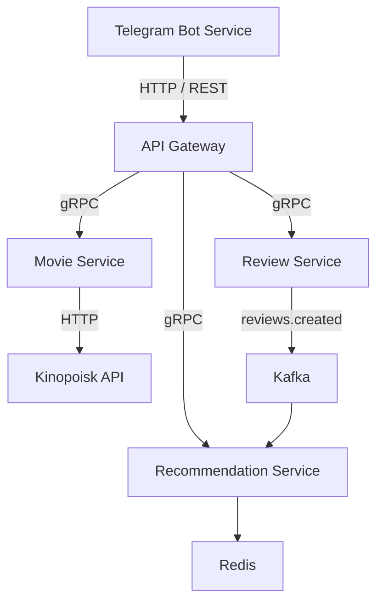

# Movie Recommendation Platform

Микросервисный backend платформы для подбора фильмов, пользовательских оценок и персональных рекомендаций с Telegram-интерфейсом.

Проект объединяет пять независимых Go-модулей. Синхронные API описываются через gRPC и Protocol Buffers, для событий используется Kafka. Данные фильмов, оценок и пользователей хранятся в PostgreSQL, ленты рекомендаций — в Redis.

## Компоненты

| Сервис | Назначение |
| --- | --- |
| [Telegram Bot Service](telegram-bot-service/) | Telegram-интерфейс, хранение пользователей и HTTP-клиент API Gateway |
| [API Gateway](api-gateway/) | HTTP-вход в платформу: маршрутизация запросов, аутентификация и Swagger |
| [Movie Service](movie-service/) | Работа с каталогом фильмов в PostgreSQL и клиент внешнего API Kinopoisk |
| [Review Service](review-service/) | Приём и получение пользовательских оценок через gRPC, публикация событий через Transactional Outbox |
| [Recommendation Service](recommendation-service/) | Построение рекомендаций, хранение ленты в Redis, обработка и публикация Kafka-событий |

## Архитектура

Проектная схема взаимодействия компонентов:



Каждый сервис владеет своими данными. PostgreSQL используется отдельно для фильмов, оценок и пользователей бота.

## Основные решения

- **gRPC API оценок.** Добавление оценки фильма и получение последних оценок пользователя. Допустимые значения оценки — от 1 до 5.
- **Transactional Outbox.** Оценка и событие записываются в одной транзакции PostgreSQL. Фоновый воркер читает outbox и публикует события в Kafka.
- **Персональные рекомендации.** Профиль предпочтений строится по оценкам пользователя, жанрам, странам и годам выпуска. Кандидаты ранжируются, уже оценённые фильмы исключаются из выдачи.
- **Кэш рекомендаций.** Готовая лента сохраняется в Redis с настраиваемым TTL. Значение в примере конфигурации — 24 часа.
- **Интеграция с Kinopoisk.** HTTP-клиент для получения информации о фильмах и видео с преобразованием внешних DTO в доменную модель.
- **Инфраструктура.** SQL-миграции Goose, структурированное логирование Zap, конфигурация через переменные окружения, Docker и Docker Compose.

## Стек

| Область | Технологии |
| --- | --- |
| Backend | Go, gRPC, Protocol Buffers, HTTP/REST, Fiber, Telebot |
| Хранение данных | PostgreSQL, pgx, Goose, Redis |
| События | Apache Kafka, Sarama, Transactional Outbox |
| Логирование | Zap |
| Окружение | Docker, Docker Compose |
| Тестирование | Go testing, Testify, GoMock |

## Локальный запуск

### Требования

- Git.
- Docker с плагином Docker Compose.
- Go 1.26 или новее — для локальной сборки и проверок вне контейнеров.
- `grpcurl` — для выполнения примеров gRPC-запросов.

### Review Service

Изолированный стенд Review Service включает приложение, PostgreSQL, Kafka, ZooKeeper и веб-интерфейс AKHQ.

```bash
git clone https://github.com/dkaplinskii/movie-recomendation.git
cd movie-recomendation/review-service
cp .env.example .env
docker compose up -d --build
```

При старте приложение применяет миграции базы данных и запускает gRPC-сервер и outbox-воркер.

| Компонент | Адрес с хоста |
| --- | --- |
| Review Service, gRPC | `localhost:50051` |
| PostgreSQL | `localhost:5433` |
| Kafka | `localhost:29092` |
| AKHQ | <http://localhost:8080> |

Внутри Compose-сети используются адреса `postgres:5432` и `kafka:9092`.

Просмотр логов и остановка стенда:

```bash
docker compose logs -f review-service
docker compose down
```

### Примеры запросов

Выполняются **из корня репозитория** после запуска Review Service. Proto-файл передаётся явно, поскольку gRPC reflection на сервере не включён.

Добавить оценку фильма:

```bash
grpcurl -plaintext \
  -import-path review-service/proto \
  -proto review.proto \
  -d '{"user_id":1,"film_id":301,"review":5}' \
  localhost:50051 review.ReviewService/AddReview
```

Получить последние оценки пользователя:

```bash
grpcurl -plaintext \
  -import-path review-service/proto \
  -proto review.proto \
  -d '{"user_id":1,"limit":10}' \
  localhost:50051 review.ReviewService/GetLatestReviews
```

Контракты API: [Review Service](review-service/proto/review.proto) и [Recommendation Service](recommendation-service/proto/recommendation/v1/recommendation.proto).

### Конфигурация остальных сервисов

В каждом модуле есть `.env.example` и `docker-compose.yml`. Перед запуском скопируй пример в `.env` в каталоге нужного сервиса и настрой значения для своего окружения.

| Сервис | Пример конфигурации | Основные настройки |
| --- | --- | --- |
| API Gateway | [.env.example](api-gateway/.env.example) | HTTP-порт, токены доступа, ограничения запросов |
| Movie Service | [.env.example](movie-service/.env.example) | PostgreSQL, gRPC-порт, `KINOPOISK_API_KEY` |
| Review Service | [.env.example](review-service/.env.example) | PostgreSQL, Kafka, gRPC-порт |
| Recommendation Service | [.env.example](recommendation-service/.env.example) | Redis, Kafka, TTL и параметры алгоритма |
| Telegram Bot Service | [.env.example](telegram-bot-service/.env.example) | `BOT_TOKEN`, PostgreSQL, адрес API Gateway |

Compose-файлы описывают отдельные окружения с повторяющимися портами и экземплярами инфраструктуры. Для совместного запуска сервисов нужны согласованные порты, единая сеть и адреса общих зависимостей.

## Проверки

Каждый сервис — самостоятельный Go-модуль. Команды ниже выполняются из корня репозитория:

```bash
go -C api-gateway test ./...
go -C movie-service test ./...
go -C review-service test ./...
go -C recommendation-service test ./...
go -C telegram-bot-service test ./...
```

Для статической проверки используй `go vet ./...` из каталога соответствующего сервиса. Тесты бизнес-логики находятся в Review Service и Recommendation Service.

## Интеграция сервисов

В текущей версии реализованы отдельные компоненты платформы. Для сквозного сценария через Telegram необходимо подключить бизнес-маршруты API Gateway и обработчики команд бота, а также согласовать Kafka-контракты между сервисами.

В точке сборки Recommendation Service используются stub-клиенты Movie Service и Review Service с фиксированными данными. Их подключение находится в [internal/app/app.go](recommendation-service/internal/app/app.go); интерфейсы клиентов и логика рекомендаций вынесены в отдельные компоненты.
